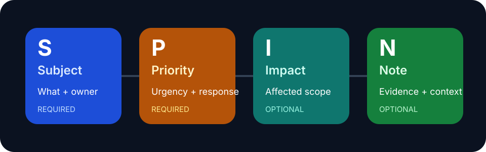

# Clear issues. Appropriate urgency. Better engineering.

S.P.I.N. is a lightweight communication standard for engineering teams. Four predictable fields make issues easier to understand, route, and prioritise without adding another process.

> Raise issues early. Communicate clearly. Escalate appropriately.

<div class="spin-grid" markdown>
<div class="spin-card spin-card--s" markdown>
## S — Subject
What needs attention—and who should act when ownership is known.
</div>
<div class="spin-card spin-card--p" markdown>
## P — Priority
Actual urgency and the response the situation requires.
</div>
<div class="spin-card spin-card--i" markdown>
## I — Impact
What is affected, at what scope, and in which environment.
</div>
<div class="spin-card spin-card--n" markdown>
## N — Note
Concise evidence, context, references, or a workaround.
</div>
</div>

## A complete message in seconds

```text
Subject: @Backend | Correct leaderboard payout response

Priority: High | UAT | Release Blocker

Impact: Frontend integration testing cannot complete. Scheduled release validation is blocked.

Note: API response differs from the agreed contract. Ticket ENG-1042.
```

Only **Subject** and **Priority** are required. Ownership is expressed in Subject. Impact and Note add useful context without turning a short report into a second ticket.



[Get started](getting-started.md){ .md-button .md-button--primary }
[Read the specification](specification.md){ .md-button }

## Designed to fit, not replace

S.P.I.N. works alongside Jira, GitHub Issues, Teams, Slack, ServiceNow, PagerDuty, xMatters, release management, on-call practice, and incident response. Existing organisational policy always wins.

A suspected security incident must follow the established security reporting process immediately—even when impact is unknown.

